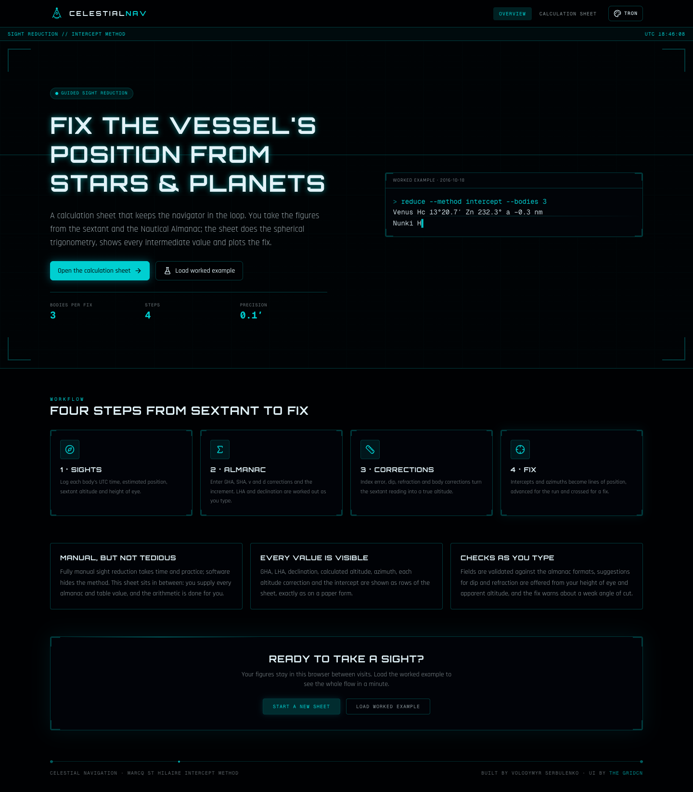
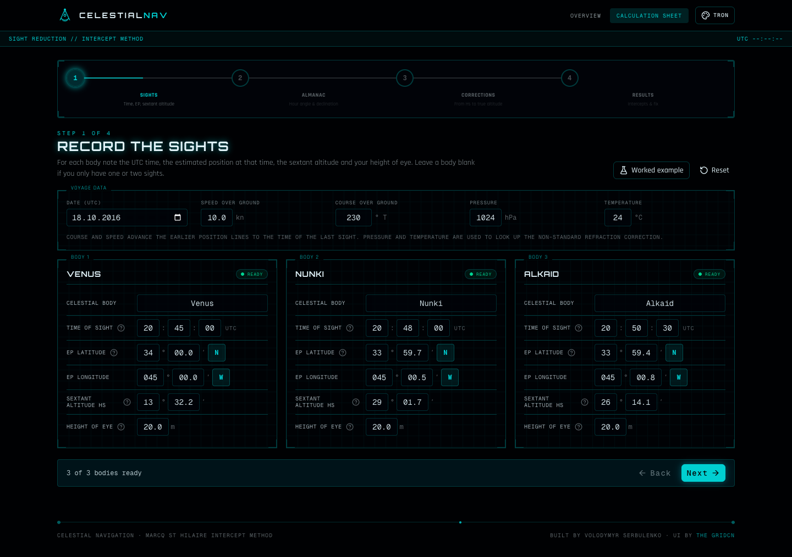
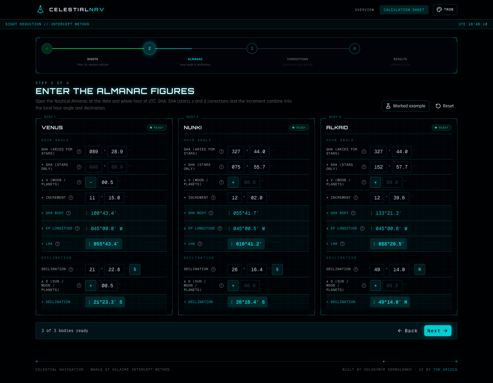
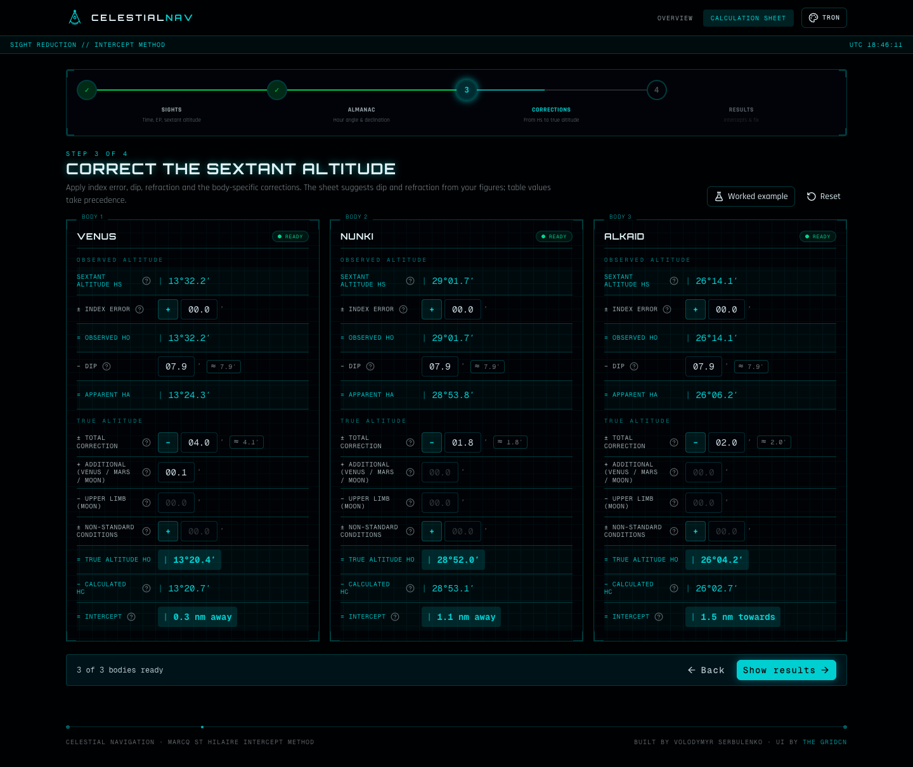
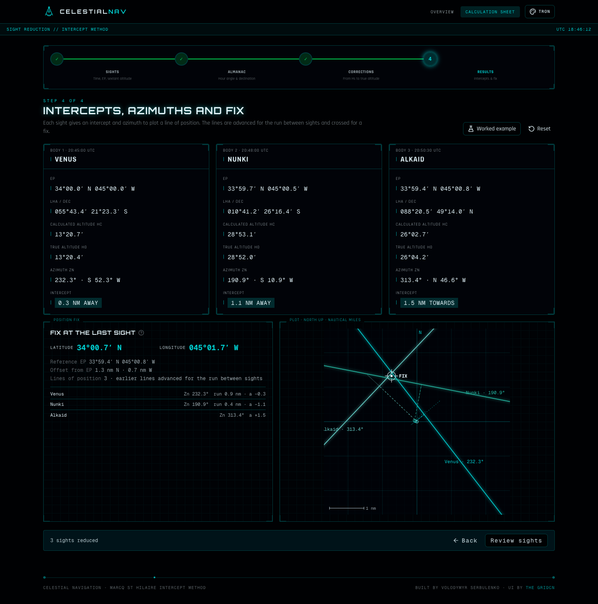

# Celestial Navigation · Sight Reduction Sheet

Fix the vessel's position from stars and planets with the intercept (Marcq St Hilaire) method.

A guided calculation sheet for watch officers: you take the figures from the sextant and the Nautical Almanac, the sheet does the spherical trigonometry, shows every intermediate value exactly as on a paper form, and plots the fix.

## Workflow

1. **Sights** — UTC time, estimated position, sextant altitude and height of eye for up to three bodies.
2. **Almanac** — GHA (Aries for stars), SHA, v and d corrections, increment and declination. LHA and corrected declination are computed live.
3. **Corrections** — index error, dip, refraction, additional / upper-limb / non-standard corrections. Dip and refraction suggestions are derived from your figures; table values can still be typed in.
4. **Results** — calculated altitude, true and quadrantal azimuth, intercept (towards / away) per body, plus a plot of the lines of position and the least-squares fix. Earlier lines are advanced along the course for the run between sights.

Everything you type stays in the browser (localStorage). Use **Worked example** to load the sample sights (Venus, Nunki, Alkaid · 2016‑10‑18) and **Reset** to start over.

## Preview







## Stack

- [Next.js 16](https://nextjs.org) (App Router, static export) · React 19 · TypeScript
- [Tailwind CSS 4](https://tailwindcss.com) with [shadcn/ui](https://ui.shadcn.com)
- [The Gridcn](https://thegridcn.com) — Tron‑inspired HUD components and the six colour themes (switchable in the header)
- [zustand](https://zustand.docs.pmnd.rs) for persisted form state, [vitest](https://vitest.dev) for the navigation core

The navigation maths lives in `lib/celestial/` and has no UI dependencies:

| Module        | Contents                                                                                     |
| ------------- | -------------------------------------------------------------------------------------------- |
| `angle.ts`    | degrees ⇄ degrees‑minutes, 0–360° normalisation, formatting                                 |
| `validate.ts` | lenient parsing and zero‑padded normalisation of every field type                            |
| `reduce.ts`   | GHA/LHA, declination, Hc (altitude), Zn (azimuth via `atan2`), altitude corrections, intercept |
| `fix.ts`      | lines of position, run advancement, least‑squares fix, angle‑of‑cut warning                  |

## Development

```bash
npm install
npm run dev        # http://localhost:3000
npm test           # vitest · navigation core
npm run typecheck
npm run lint
npm run build      # static export to ./out
```

Add more Gridcn components with the shadcn CLI, for example `npx shadcn@latest add @thegridcn/radar`.

## Deployment

`.github/workflows/deploy.yml` builds the static export and publishes it to GitHub Pages (set the repository's Pages source to **GitHub Actions**). The base path is taken from `NEXT_PUBLIC_BASE_PATH`.

## Author

Volodymyr Serbulenko · serbulenko1volodymyr@gmail.com
